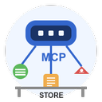
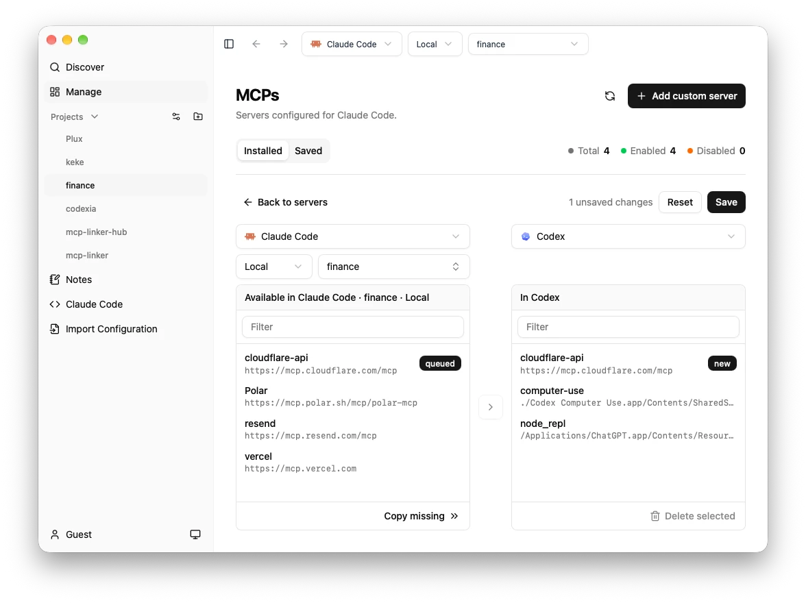
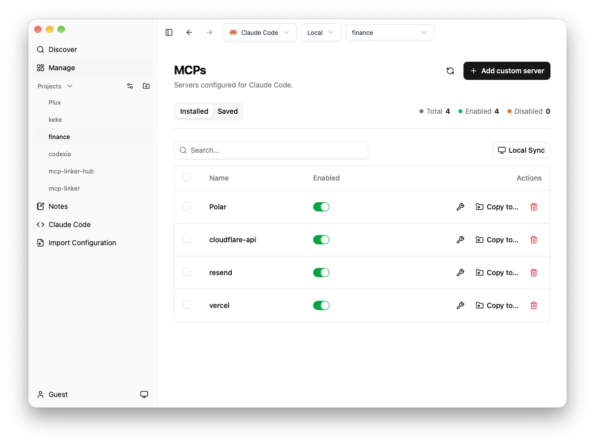

<div align="center">



# MCP Linker

[](https://github.com/milisp/mcp-linker/releases)
[](https://github.com/milisp/mcp-linker/stargazers)
[](https://github.com/milisp/mcp-linker/releases)
[](#)
[](../CONTRIBUTING.md)

[English](../README.md) · [简体中文](./README.zh-CN.md) · [繁體中文](./README.zh-TW.md) · [日本語](./README.ja-JP.md) · [Deutsch](./README.de.md) · **Français** · [Español](./README.es.md)

**Ajoutez et synchronisez en un clic serveurs MCP, skills et plugins entre vos clients IA — aucun appel à un LLM, marketplace intégrée**

[](https://github.com/milisp/mcp-linker/releases/latest)

`brew install mcplinker` · [Autres options d'installation](#installation)

</div>

> [!TIP]
> ⭐ Mettez une étoile au dépôt et suivez **milisp** sur [Twitter](https://x.com/lisp_mi) et [GitHub](https://github.com/milisp) pour en savoir plus !



## 🚀 Pourquoi MCP Linker ?

- ⚡ **Instantané** — Ajoutez des serveurs MCP, des skills et des plugins en quelques secondes
- 🧠 **Multi-clients** — Compatible avec tous les principaux clients IA

## ✨ Fonctionnalités

- **Synchronisation locale** — Synchronisez les configurations de serveurs MCP entre plusieurs clients
- **Registre MCP officiel** — Parcourez et installez des serveurs directement depuis registry.modelcontextprotocol.io
- **Skills** — Catalogue sélectionné et catalogue communautaire, installation depuis n'importe quel dépôt GitHub, activation par client pour Claude Code et Codex. Même organisation que `npx skills`. [Voir le détail](./skills.md)
- **Plugins** — Parcourez les marketplaces de plugins de Claude Code et de Codex, et copiez des plugins de l'un à l'autre dans un panneau de synchronisation. [Voir le détail](./plugins.md)
- **Multi-clients** — Claude Desktop/Code, Codex, Cursor, VS Code, GitHub Copilot CLI, Cline, OpenCode, Pi, Hermes Agent. [Voir le détail](./clients.md)
- **Multiplateforme** — macOS, Windows, Linux
- **Détection intelligente** — Détecte automatiquement les environnements Python, Node.js et uv

## 🚀 Démarrage rapide

### Installation

**macOS (Homebrew)**
```bash
brew install mcplinker
```

**Arch Linux (AUR)**
```bash
yay -S mcp-linker-bin
```

**GitHub Releases (binaires précompilés)**
[Télécharger](https://github.com/milisp/mcp-linker/releases)

> [!Note]
> Si vous avez souscrit un abonnement, relancez l'application après votre première connexion.

### Premiers pas

1. **Parcourez** les serveurs MCP dans la marketplace intégrée
2. **Cliquez sur « Get »** pour afficher la configuration
3. **Cliquez sur « Add »** pour l'installer dans le client de votre choix
4. **C'est fait !** Profitez immédiatement de nouvelles capacités IA

### CLI

`mcpl` fait la même chose depuis le terminal, sans application : `npm install -g @milisp/mcpl`,
ou `npx @milisp/mcpl` pour l'essayer. Les binaires sont disponibles dans les [versions `mcpl-v*`](https://github.com/milisp/mcp-linker/releases).

```bash
# Add one server to Claude Code, Codex and Cursor at once
mcpl add fs -c claude-code -c codex -c cursor -- npx -y @modelcontextprotocol/server-filesystem ~/work

mcpl ls                                  # every client on this machine
mcpl sync --from claude-code --to codex  # copy servers between clients (license)
mcpl skill install owner/repo            # install skills for Claude Code and Codex
mcpl plugin ls                           # plugins of Claude Code and Codex
```

Consultez [cli.md](./cli.md) pour toutes les commandes.

## Captures d'écran

| Synchronisation locale entre projets | Découverte de serveurs | Gestion |
|-----------------------------|------------------|--------|
|  |  |  |

## Qu'est-ce que MCP ?
Le Model Context Protocol est un peu l'USB-C de l'IA : une façon standard de connecter les modèles d'IA à différentes sources de données et à différents outils.

## 🤝 Ajoutez votre serveur MCP

Vous avez créé un serveur MCP, ou vous en exploitez un pour votre produit ? **Soumettez-le à l'annuaire.** Tout serveur fonctionnel et sûr est le bienvenu, même tout récent. Ouvrez une pull request qui ajoute un fichier JSON : voir [comment ajouter un serveur](../registry/README.md#adding-a-server) et les [critères de référencement](../CONTRIBUTING.md#listing-an-mcp-server).

Vous avez créé un plugin Claude Code (serveurs MCP + skills) ? **Référencez-le aussi** : une entrée dans la marketplace de plugins, pointant vers votre dépôt. Voir [soumettre votre plugin](../plugins/README.md#submitting-your-plugin).

Vous avez un skill (`SKILL.md`) ? **Référencez-le sur la page Skills** : une entrée dans [`skills/catalog.json`](../skills/catalog.json). Voir [skills.md](./skills.md).

## 🧭 Projets associés

- [milisp/codexia](http://github.com/milisp/codexia) - Poste de travail d'agents pour Codex et Claude Code.
- [**awesome-claude-dxt**](https://github.com/milisp/awesome-claude-dxt) — une liste sélectionnée d'extensions Claude Desktop (dxt), d'outils et de ressources
- [**awesome-codex-cli**](https://github.com/milisp/awesome-codex-cli) — liste sélectionnée d'outils, de plugins, de skills et de MCP pour Codex

## 💬 Communauté et support

- [💬 Rejoindre Discord](https://discord.gg/zAjtD4kf5K)
- [💬 Rejoindre les discussions](https://github.com/milisp/mcp-linker/discussions)
- [🐛 Signaler un problème](https://github.com/milisp/mcp-linker/issues)

## 🛠️ Développement

Pour les commandes de développement et les consignes de contribution, consultez [CONTRIBUTING](../CONTRIBUTING.md)

## 🔍 Dépannage

Consultez le [Wiki](https://github.com/milisp/mcp-linker/wiki)

## 💖 Contributeurs

Merci à tous nos formidables contributeurs !

<a href="https://github.com/milisp/mcp-linker/graphs/contributors">
  
</a>

## Licence

MCP Linker est distribué sous double licence : **AGPL-3.0** et **licence commerciale**.

- **AGPL-3.0** — pour un usage open source.
- **Licence commerciale** — requise pour un usage closed source, propriétaire, hébergé ou SaaS.

---
**Ce projet vous est utile ? Mettez-lui une ⭐ !**

## 📈 Historique des étoiles

[](https://star-history.com/#milisp/mcp-linker)
